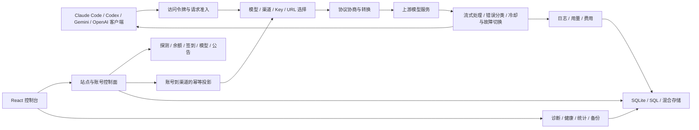

# PivotFlow 项目现状与近期进展

审阅日期：2026-11-19，Asia/Shanghai。基线是本机主项目的已提交代码；GitHub 发布与分支状态另行读取原始 API 核对。本轮未实现新的网关功能。

## 1. 当前版本与项目定位

| 项目 | 核实结果 | 证据 |
| --- | --- | --- |
| 主仓库 | `yzgolden86/PivotFlow`，分支 `main` | 本地 remote / GitHub |
| 本地基线 | `90aee95761d8fa21ab3f292b3b2930f8fa24be08` | [对应提交](https://github.com/yzgolden86/PivotFlow/commit/90aee95761d8fa21ab3f292b3b2930f8fa24be08) |
| GitHub `main` | 同一提交 | [分支原始 API](https://api.github.com/repos/yzgolden86/PivotFlow/commits/main) |
| 最新稳定发布 | `v0.4.9`，2026-10-24 06:13:08 UTC，即北京时间 14:13:08 | [Release](https://github.com/yzgolden86/PivotFlow/releases/tag/v0.4.9)、[发布原始 API](https://api.github.com/repos/yzgolden86/PivotFlow/releases?per_page=5) |
| 最近主要功能发布 | `v0.4.8`，统一数据面板及费用口径；`v0.4.9`，New API 计费与探测修正 | [v0.4.8](https://github.com/yzgolden86/PivotFlow/releases/tag/v0.4.8)、[版本差异](https://github.com/yzgolden86/PivotFlow/compare/v0.4.8...v0.4.9) |
| 技术栈 | Go 1.26.10，Gin，Sonic，SQLite / MySQL / PostgreSQL；React 18，React Router，Vite，TypeScript | [go.mod](../../../go.mod)、[console/package.json](../../../console/package.json) |

PivotFlow 已形成“个人 AI 网关 + 上游站点管理”的完整方向。它的价值是让上游资产、客户端接入、请求路由、费用和故障排查形成一条工作流。单纯把参考项目的页面或功能清单继续叠加进来，容易增加维护负担；下一阶段应围绕“更快接入、更容易解释、故障时更可信”完善现有能力。

本机保留的 `pivotflow.exe` 仍来自 `6bc0ebe`（v0.4.8 源码）。只读命令 `go version -m pivotflow.exe` 核实其 `vcs.revision=6bc0ebee7e89aec5eba845030e8da5083641d330`，而当前源码已经是 v0.4.9。重新使用本机二进制前，应在依赖正常的环境构建最新源码，或使用 v0.4.9 发布产物；本轮未替换该可执行文件。

`HANDOFF.md` 保留了历史诊断、被否决方案和环境经验，对维护有价值，但其中的“本次”“未完成”和历史测试结果不等于当前状态。本报告按代码与提交记录重新判断，不把已经完成的工作再次列成新需求。

## 2. 架构与职责

| 目录 | 当前职责 | 审阅入口 |
| --- | --- | --- |
| `internal/app` | 管理 API、代理编排、选择器、统计、站点任务、OAuth、运行状态 | [server.go](../../../internal/app/server.go)、[proxy_handler.go](../../../internal/app/proxy_handler.go)、[site_control.go](../../../internal/app/site_control.go) |
| `internal/protocol` | 四协议注册边界、请求语义、JSON / SSE 转换 | [registry.go](../../../internal/protocol/registry.go)、[适配层](../../../internal/protocol/builtin/cliproxy_adapter.go) |
| `internal/protocol/cliproxy` | 固定提交的纯转换核心，并保留本地线协议修正 | [来源记录](../../../internal/protocol/cliproxy/UPSTREAM.md) |
| `internal/cooldown` | 将重试决策和凭据、模型、渠道惩罚分开 | [decision.go](../../../internal/cooldown/decision.go)、[manager.go](../../../internal/cooldown/manager.go) |
| `internal/site/provider` | 各类站点契约、传输、防止错误凭证判断、价目表 | [provider.go](../../../internal/site/provider/provider.go)、[transport.go](../../../internal/site/provider/transport.go) |
| `internal/storage` | 建库迁移、SQL 与 SQLite、主库和本地副本同步 | [factory.go](../../../internal/storage/factory.go)、[hybrid_store.go](../../../internal/storage/hybrid_store.go) |
| `console/src` | 当前 React 管理控制台 | [App.tsx](../../../console/src/App.tsx)、[样式](../../../console/src/styles.css) |
| `web` | 编译时嵌入的正式静态资源与登录页 | [embed.go](../../../embed.go) |
| `www` | 独立介绍网站，不是管理后台 | [说明](../../../www/README.md) |
| `scripts`、`.agents/skills` | 可复用验证、合成截图、发布、协议同步 | [Makefile](../../../Makefile)、[维护说明](../../maintenance.md) |

整理文件时必须保留 `web/console`：它是正式发布内容，Go 的 `all:web` 会把它嵌进二进制。`www` 也有独立职责。它们都不能因为“是生成的 / 另一个前端”就当作临时目录删除。

## 3. 已实现能力清单

| 领域 | 已实现内容 | 对可靠性或便利性的意义 |
| --- | --- | --- |
| 站点管理 | New API / One API 系、AnyRouter、Veloera、Sub2API 与 OpenAI Compatible 兜底；站点探测、代理、时区、启停 | 各 Provider 有明确契约，避免把兼容声明当成任意站点都支持 |
| 账号管理 | 加密凭证，Cookie / Token / OAuth 等不同凭证路径；余额、模型、认证状态 | 账号管理凭证与模型调用 Key 有清楚边界 |
| 站点投影 | 账号和分组到渠道的幂等绑定、同步进度、冲突和错误状态 | 不必在账号和渠道两页重复维护同一组连接 |
| 签到 | 手动、按账号 / 站点时区定时签到、能力发现、结果历史、分类重试、人工浏览器入口 | 已签到、404、不支持、人机验证和暂时失败有不同处理；不是无条件反复重试 |
| 公告与通知 | 聚合公告、已读、详情；低余额和签到失败的 Webhook / Telegram | 将维护操作集中在控制台 |
| 模型管理 | 发现与刷新、账号直测、渠道测试、统一映射、重定向、停用标记 | 统一映射已能热生效；刷新模型不会悄悄重新启用已停用模型 |
| 路由 | 优先级层、按有效 Key 数平滑加权轮询、可选健康和 TTFB 排序、可用时间窗 | 默认策略和评分策略分开，诊断可解释理论份额 |
| Key 与 URL | 多 Key、Key 模型范围与健康管理、批量录入；多 URL 的 EWMA 与独立冷却 | 认证问题、特定模型问题和网络端点问题可以分开处理 |
| 粘性 | 普通 HTTP 的 Token + 模型粘性，30 分钟过期；成功记忆、失败清除 | 已有粘性路由，后续建议应针对会话粒度和命中原因，而非重复开发同名功能 |
| 协议 | OpenAI Chat Completions / Responses、Anthropic Messages、Gemini；auto / upstream / local；四协议间 12 个有向转换对 | 同协议保留透传；不支持的请求语义应明确拒绝或能力协商 |
| Responses WebSocket | 原生连接与 HTTP SSE 桥接、显式会话、完整 transcript、线程隔离、重连、TTL、连接与内容预算 | 对 Codex 的会话身份和语义输出边界有专门设计，不能用普通无状态反代替代 |
| 错误恢复 | Key / 模型 / 渠道分级冷却；Retry 与 Effect 解耦；精确 reset 规则；全部冷却可选兜底 | 保持故障范围与重试范围一致，不因客户端取消惩罚上游 |
| 限流与费用 | 全局 / Token / 渠道并发、渠道 RPM、Token 成本限额、渠道日限额、倍率快照 | 控制不同层级的资源；费用限额仍是完成后计费的软限制 |
| 定价 | 本地价格与站点价目来源、用户组倍率、按次计费、缓存读取和 5m / 1h 写入 | 费用可说明来源，避免重复倍率和缓存重复计费 |
| 观测 | 请求日志、活动请求、Key 健康、路由诊断、运行中调试报文、统一数据面板 | 已有诊断基础，下一步应将这些入口围绕同一个请求连接起来 |
| 访问控制 | 管理会话、模型调用令牌、模型 / 渠道 / 协议限制；独立只读系统诊断令牌 | 外部诊断可以仅获得受限数据，无需共享管理会话 |
| 数据与备份 | SQLite、MySQL、PostgreSQL、混合副本；三类 JSON 导入导出、手动 / 定时 WebDAV 备份 | 迁移与恢复已有基础，后续重点应是恢复验证和同步差异预览 |
| UI | 统一组件与设计令牌、主题、布局密度和宽度、壁纸、自由 CSS、全局搜索、移动断点 | 外观能力已经丰富，应把新增投入转向接入与诊断任务 |
| 发布 | Tag 验证、多平台二进制、校验和、同发布镜像、stable / beta 标签 | 非容器后台当前只读检查；容器通过镜像标签升级 |

细节分别见 [路由](../../routing.md)、[站点](../../site-management.md)、[安全与备份](../../security.md)、[Key 健康](../../key-health.md)。UI 的逐页检查与交互建议见 [本项目 UI 审阅](pivotflow-ui-audit.md)。

## 4. 最近的开发主线

| 时间 | 代表提交 / 版本 | 主要变化 |
| --- | --- | --- |
| 2026-08-13 | `9a5c681` | 引入 PivotFlow 控制面，将站点、账号与路由整合 |
| 2026-08-15 至 08-18 | `57bd8c2`、`6d7a631`、`41d0ae6` | 批量管理、模型发现、兼容 Provider、自动签到、通知与备份 |
| 2026-08-21 至 08-28 | `f8480bd`、`ff5547f`、`8b3cd0c`、`325f9c1` | 路由诊断、可用时间窗、渠道同步进度、运行设置与诊断令牌 |
| 2026-08-30 至 09-04 | `c81c866`、`672d2a0`、`f2b66be`、`9732029`、`19d9fc4` | 粘性策略、站点倍率计费、Retry / Effect 解耦、模型统一名称与令牌白名单 |
| 2026-09-08 至 09-16 | `c237bbe`、`beebc6b`、`169ebe8` | Key 健康和模型范围、详细诊断、价格对比与统计展示 |
| 2026-09-17 至 09-20 | `63e2950`、`2122d29`、`34d5c71`、`607c285`、`b58059c` | 签到能力与结果历史、重试收敛、全站视觉统一、模型映射热生效 |
| 2026-09-28 至 10-04 | `ca3a47c`、`ec04da8`、`50ad45d`、`8c454af`、`39781ea`、`482f757` | 外观自定义、毛玻璃和滚动性能修正、批量 Key、单 Key 检测可发现性 |
| 2026-10-17 / v0.4.6 | `aca6ebf` | 余额刷新先直连，避免 WAF 状态黏住；修正 Cookie 与提示路径 |
| 2026-10-22 / v0.4.7 | `9f163a8` | 要求 Go 1.26.10 工具链 |
| 2026-10-23 / v0.4.8 | `6bc0ebe` | 统一数据面板、站点费用口径与统计过滤 |
| 2026-10-24 / v0.4.9 | `90aee95` | 对齐 New API 实际计费表达式、缓存桶、分组与探测契约 |

这是按用户可感知的主题整理的进展，不是逐条罗列所有维护和交接提交。

### v0.4.8 的实质

- 将原趋势页并入数据面板，保留旧入口的跳转，减少重复的统计入口。
- 统一首页、日志、Token 统计与 SQL 聚合的费用口径。`site_pricing` 的费用已经含站点与用户组倍率，不再重复乘本地渠道倍率。
- 免费渠道的 `cost_multiplier=0` 有明确语义；负倍率回退到 1。统计显示实际倍率区间，避免把不同记录都假装成当前设置值。
- 最近成功 / 最近失败 / 最近请求状态和当前时间窗的统计区分；模型、渠道、来源、实际协议等过滤有对应回归。
- 计费缓存先于数据库更新：数据库统计写入失败时，内存限额不会因此直接放开。**这修正了 DB 失败路径，但没有消除队列饱和路径。**

证据：[功能提交](https://github.com/yzgolden86/PivotFlow/commit/6bc0ebee7e89aec5eba845030e8da5083641d330)、[proxy_error.go](../../../internal/app/proxy_error.go)、[SQL 统计测试](../../../internal/storage/sql/metrics_basic_test.go)、[首页测试](../../../internal/app/admin_dashboard_test.go)。

### v0.4.9 的实质

- 从 New API `billing_expr` 提取可支持的价格项，无法安全计算的表达式明确回退，避免靠显示倍率猜真实扣费。
- 缓存读取、5 分钟和 1 小时写入分别计算；“未给缓存项”和“显式为 0”不同。
- 按次模型使用完整单次费用，不因 Token 计价表达式复杂而误丢该费用。
- 渠道前缀模型名仅在唯一匹配时消歧；不在多个候选价目之间随意选择。
- 用户组绑定优先；旧绑定缺分组时，仅在能唯一推断的情况下补足。
- 渠道绑定变化仅失效绑定缓存，保留仍有效的站点价目表，降低无关操作导致的重复取价与“本地估算”抖动。
- New API 站点探测与版本、计费契约同步修正，并扩充对应测试。

证据：[功能提交](https://github.com/yzgolden86/PivotFlow/commit/90aee95761d8fa21ab3f292b3b2930f8fa24be08)、[价目适配](../../../internal/site/provider/newapi_pricing.go)、[计算与缓存](../../../internal/app/site_pricing.go)、[Provider 测试](../../../internal/site/provider/newapi_pricing_test.go)、[应用层测试](../../../internal/app/site_pricing_test.go)。

## 5. 值得优先处理的可靠性缺口

以下是从当前代码得到的具体条件与边界，不代表这些故障已经在生产发生。优先级以个人网关长期运行的目标提出，后续实施需要独立设计与验收。

| 编号 | 已观察到的实现边界 | 用户影响 | 建议方向 |
| --- | --- | --- | --- |
| R1 | `updateTokenStatsAsync` 等待 100ms 后，队列持续满时仍会丢弃成功请求统计；限额累加位于消费者 | 极端饱和时成功请求可能漏记费用或限额累加；与“DB 写失败仍限制”是不同路径 | 成功费用使用同步兜底或可恢复的计费记录；明确一次请求的幂等身份与重试落账语义 |
| R2 | 活动请求的运行期 ID 已跨尝试复用，但只保存当前快照、完成即删除；日志仅有行 ID，未保存运行期 ID、尝试序号和最终请求结果的持久关联 | 请求结束后难以回答“之前试过哪些 Key / URL / 协议，为什么最后成功 / 失败” | 复用现有 BeginAttempt 生命周期，增加可持久查询的请求身份、尝试记录与最终结果 |
| R3 | `/admin/runtime-metrics` 当前主要公开 Responses WS 资源；日志丢弃、计费队列丢弃、混合同步丢弃有内部计数但未统一公开 | 控制台可能显示“进程正常”，同时统计已经不完整 | 暴露队列深度、丢弃、刷盘失败、同步失败、恢复时间；有限基数的 Prometheus 或 JSON 指标 |
| R4 | 费用在完成后得到，准入是预检查；并发在途请求可同时通过限制 | 日限额与 Token 限额是软约束，超量取决于在途并发与请求价格 | 在 UI 中说明软限额；个人部署先配并发；若要严格额度，再设计预留、结算和退款 |
| R5 | 站点价目缓存 miss 可能并发取价，虽然已防止失败覆盖有效成功结果；控制面任务会访问同一站点多个端点 | 冷启动、批量刷新、签到与同步叠加可能触发 WAF 或接口限流 | 按站点聚合请求预算、singleflight、随机错峰、可取消队列、失败 TTL；浏览器验证仍交给用户 |
| R6 | `site_pricing` 是根据上游价目表和返回用量计算，尚不是已核对的上游消费账单 | “费用来自站点”容易被理解成“已和账单逐项对过” | 区分站点价目估算、本地公开价估算、上游账单确认；保留价格来源与时间，提供差异解释 |
| R7 | 管理会话仍在浏览器 localStorage；现有文档已经记录这个架构边界 | 管理会话的浏览器读取面仍需要收敛 | 将 HttpOnly Cookie、Origin / CSRF、登录登出与反代回归作为同一项改动设计 |
| R8 | 转换核心来源记录为 2026-08-05 的固定提交，且保留许多本地线协议差异 | 后续上游新工具、字段或模型语义需要逐项评估，不能因版本变新就全量覆盖 | 按仓库同步 Skill 只移植纯转换差异，同时保留 Registry 边界和同提交上游测试 |
| R9 | 代理 HTTP client 未设置 CheckRedirect；Provider 已限制主机与地址，但不按完整 origin 检查 | 上游 30x 可能将非标准认证头带往其他 origin；尚未故障注入，不能据此声称已有生产泄露 | 按请求用途明确拒绝跨 origin 或逐跳重建认证，回归 x-api-key、x-goog-api-key、自定义敏感头与同源跳转 |

证据：[R1](../../../internal/app/proxy_error.go)、[R2 日志模型](../../../internal/model/log.go)、[R3 运行指标](../../../internal/app/admin_active_requests.go)、[日志队列](../../../internal/app/log_service.go)、[混合同步](../../../internal/storage/hybrid_store.go)、[R4 准入](../../../internal/app/proxy_handler.go)、[R5–R6](../../../internal/app/site_pricing.go)、[R7](../../../console/src/main.tsx)、[R8](../../../internal/protocol/cliproxy/UPSTREAM.md)、[R9 代理 client](../../../internal/app/upstream_connection_age.go)、[认证头](../../../internal/app/proxy_util.go)、[Provider](../../../internal/site/provider/transport.go)。

已有机制也应继续守住：流式内容已提交后不能随意重放；客户端取消不惩罚上游；原生协议不支持是能力协商事件；会话身份不能改成 prompt cache key；设置只有注册真实消费者才能编辑；诊断不能推进轮询。改进建议不能破坏这些正确性边界。

## 6. 本轮实际修正的文档与整理规则

- `docs/configuration.md` 和 `docs/troubleshooting.md`：模型统一映射已于 `b58059c` 热生效，删除“保存后必须重启”的旧描述。
- `CLAUDE.md`：纠正热生效例外、当前 `ApplyUpdates=false` 的只读检查模式，以及免费 / 负倍率 / 站点价目费用口径。
- `.gitignore`：补充 `.tmp/` 和 `.tmp_*/`，保留既有 `.tmp-*/` 规则。
- `.dockerignore`：排除临时验证目录、Go 缓存、console 依赖和本机 Windows 二进制，避免重新把大体积开发产物送入镜像构建上下文。
- 两份 README 的 Octopus 致谢同时标明 `bestruirui` 上游和实际参考的 `Hureru` fork，避免混淆独立发展分支。`docs/README.md` 新增本轮研究入口。
- 正式源码、`web/console`、用户 `data/`、本机当前可执行文件与未确认用途的小配置保留；一次性材料按用途归档。

清理的精确统计、保留文件校验与归档位置见 [清理报告](workspace-cleanup.md)。

## 7. 本轮验证及局限

| 检查 | 结果 | 能说明什么 |
| --- | --- | --- |
| 本地 Git 和 GitHub 原始 API | HEAD 与 `main` 一致，最新稳定发布 v0.4.9 | 版本与进展以真实提交为准 |
| `npm --prefix console run typecheck` | 通过 | 应用与测试 TypeScript 类型检查通过 |
| `npm --prefix console test` | 167 通过、0 失败、0 跳过 | 现有前端逻辑和源码守卫通过；不等于完整浏览器验收 |
| 首次 Go 内部包测试 | `proxy.golang.org` 下载连接超时，五个已具备依赖的包通过 | 依赖准备失败没有业务断言结果，保留原始记录 |
| `go test -tags sonic -count=1 -timeout 120s ./internal/...`，任务内临时镜像 | 32 个有测试的包通过、5 个包无测试；应用包在 120 秒包级总时限处超时 | 临时 `GOPROXY=https://goproxy.cn`，保留 go.sum 和默认 checksum 校验；没有业务断言失败记录 |
| `go test -tags sonic -count=1 -timeout 10m ./internal/app` | 应用包单独补跑通过，用时 80.17 秒 | 两次有业务结果的运行合计覆盖 33 个有测试的内部包；未把完整运行的初次超时改写为通过 |
| 311 份临时源码与数据归档 | CRC 与逐项 SHA-256 一致 | 删除原临时目录前已核实可取回 |

Go 依赖与编译缓存仅放在本轮 `.tmp-verification-20261119/`，验证结束后已清除；进程内环境参数没有更改系统配置。完整失败、包级超时和成功补跑的日志与结果见 [Go 验证汇总](../../../../archive/cleanup-2026-11-19/verification-logs/go-test-summary.json)。这些测试没有验证真实上游负载或完整客户端矩阵，也没有以旧 `HANDOFF` 的测试结论替代本轮结果。

本次没有启动生产实例、调用用户上游账号或触发真实签到。截图评估以合成文档图、正式 UI 源码和参考项目公开视觉资料为依据。

三项目的独立研究和跨项目建议见 [研究入口](README.md)。
